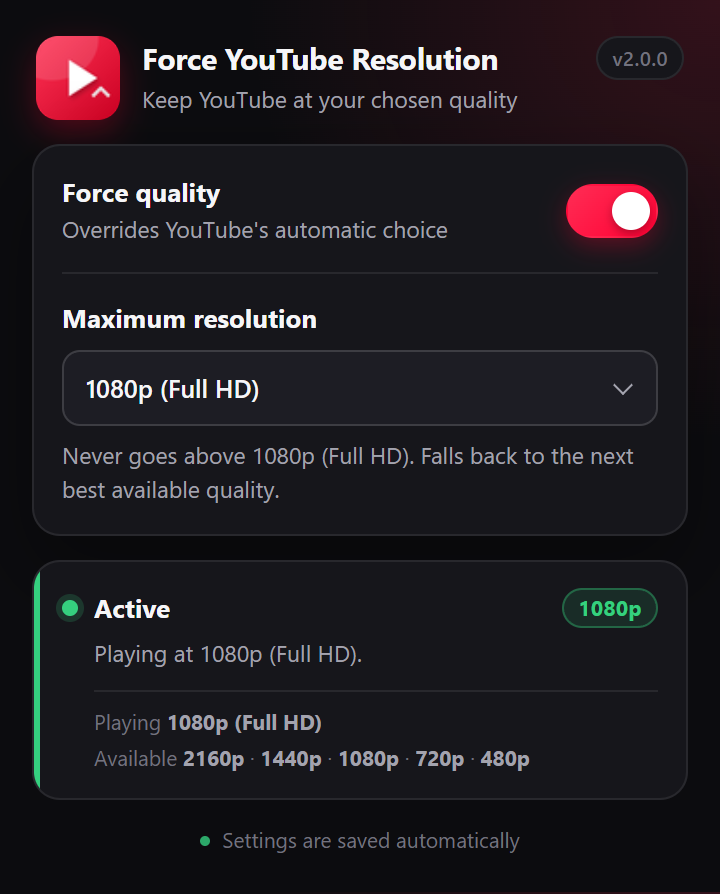

<div align="center">
  
  <h1>Force YouTube Resolution</h1>
  <p>Lock YouTube playback to one fixed resolution. Click the toolbar icon, pick a level, done.</p>
</div>

<div align="center">

[](https://developer.chrome.com/docs/extensions/mv3/intro/)
[](https://developer.mozilla.org/docs/Mozilla/Add-ons/WebExtensions/manifest_version)
[](LICENSE)
[](https://nodejs.org)

</div>

---



## The problem

YouTube's adaptive bitrate picks a resolution based on your connection, your
screen, and the codec it feels like serving today. Open the same video twice and
you can get 720p one time and 2160p the next.

Worse, setting the quality from the gear menu **doesn't stick**. YouTube
re-applies its own saved value whenever a video loads, on every buffer
underrun, and whenever the adaptive bitrate decides to step up. A setting you
made ten seconds ago is gone.

## What this does

Picks one resolution and holds it there.

- **Fixed ladder, no custom values.** 144p, 240p, 360p, 480p, 720p, 1080p,
  1440p, 2160p, 2880p, 4320p — plus `Auto` to hand control back. There is no
  way to type your own number, because a resolution outside YouTube's ladder is
  not something the player can serve.
- **Shows what the video actually offers.** The popup asks the running player
  which levels it has and marks the rest, so you can see at a glance that
  4320p is meaningless for a 480p upload.
- **Keeps re-applying.** Re-asserted on playback, buffering, video changes,
  SPA navigation and a 1.2 s self-healing poll — and only when YouTube has
  actually drifted off the target.
- **Never silently overrides you.** Ask for 4320p on a 1080p video and it uses
  1080p and says so: *"4320p is not offered here · using 1080p"*. It never
  climbs above your request and never drops back to YouTube's default.
- **The gear menu agrees with it.** The forced value is mirrored into YouTube's
  own quality menu, so the UI doesn't contradict what's on screen.

## Install

Download the packaged `.xpi` / `.crx` from the repository's
[**Releases**](../../releases) page, or build it yourself from source (below).

### Chromium — Chrome, Edge, Brave, Opera, Vivaldi, Arc

| Method | Steps |
|---|---|
| **Unpacked** (easiest) | `chrome://extensions` → enable **Developer mode** → **Load unpacked** → pick `Chromium/` |
| **The `.crx`** | enable **Developer mode**, then drag `dist/*-chromium-*.crx` onto the extensions page |
| **The `.zip`** | unzip it anywhere, then **Load unpacked** on the result |

### Firefox

| Method | Steps |
|---|---|
| **Temporary** | `about:debugging#/runtime/this-firefox` → **Load Temporary Add-on…** → pick `Firefox/manifest.json` or the `.xpi` |
| **Permanent (unsigned)** | Nightly / Developer Edition / ESR only: set `xpinstall.signatures.required = false` in `about:config`, then drag the `.xpi` onto the add-ons page |
| **Permanent (signed)** | upload the `.xpi` to [addons.mozilla.org](https://addons.mozilla.org/developers/) and publish — Mozilla signs it, no key needed, and this is the only route that works on release Firefox |

## How it works

The interesting part is *where* the code runs, and getting this wrong is why most
first attempts do nothing at all.

YouTube assigns its player API straight onto the element as **own properties**:

```js
Object.getOwnPropertyNames(document.getElementById('movie_player'))
// [..., setPlaybackQuality, setPlaybackQualityRange,
//     getAvailableQualityLevels, getPlaybackQuality, ...]
```

Own properties created by page JavaScript live in the page's JavaScript heap. An
extension content script normally runs in an **isolated world**, which shares the
DOM but *not* that heap — so from an ordinary content script:

```js
typeof document.getElementById('movie_player').setPlaybackQuality
// "undefined"
```

No exception, nothing in the console. The property simply isn't there. Any
approach built on a plain content script will fail silently.

So the extension is split in two:

| File | World | Responsibility |
|---|---|---|
| `bridge.js` | isolated | reads/writes `chrome.storage`, relays the setting to the engine, relays status to the popup, and on Firefox injects the engine |
| `force.js` | **main** | finds the player, pins the resolution, updates `localStorage["yt-player-quality"]` |

They talk over `window.postMessage`. Getting into the main world:

- **Chromium** — `"world": "MAIN"` on the content script (Chrome 111+).
- **Firefox** — MV2 has no `content_scripts.world`, so `bridge.js` appends a
  `<script src>` to the document and the engine is declared in
  `web_accessible_resources`.

Once there, forcing a resolution is three calls:

```js
const p = document.getElementById('movie_player');
const wanted = 'hd1080';
const levels = p.getAvailableQualityLevels();   // what this video really has

p.setPlaybackQuality(wanted);                   // choose it
p.setPlaybackQualityRange(wanted, wanted);      // pin it — this is the part that
                                                // stops ABR upgrading later
localStorage['yt-player-quality'] = /* … */;    // so the gear menu agrees
```

The **`setPlaybackQualityRange` call is the important one.** `setPlaybackQuality`
alone only nudges the current playback; YouTube's adaptive bitrate is still free
to step up a few seconds later. Pinning the range is what makes it stick.

### When the video can't do what you asked

YouTube only serves what an upload actually contains. The engine resolves the
request against `getAvailableQualityLevels()`:

- exact match → use it
- otherwise → the best level **at or below** the request
- if even the lowest offered level is above the request → the lowest offered

It only ever requests a label the player actually reports, and it reports which
one it used.

## Privacy

Deliberately minimal:

- `storage` — remembers the one setting you chose
- `*://*.youtube.com/*`, `*://*.youtube-nocookie.com/*` — read the player's quality list, apply the setting

No network requests. No analytics. No telemetry. No remote code. No background
service worker. No account, no sync — the setting lives in your browser's local
storage and nowhere else.

## Build from source

Node 18+, no npm dependencies.

```bash
node build.js               # -> Chromium/ and Firefox/
node tools/test-content.cjs # 43 assertions across the engine and the bridge
node tools/pack.js          # -> dist/*.xpi, dist/*.crx, dist/*.zip
```

```
Chromium/   built, load unpacked (MV3)
Firefox/    built, load unpacked (MV2)
dist/       packaged .xpi / .crx / .zip
src/        the actual sources — bridge.js, force.js, popup.*, _locales/, manifests
tools/      build, test and packaging helpers
build.js    assembles both builds and validates them
```

`Chromium/`, `Firefox/` and `dist/` are generated. Edit `src/` and rebuild.

`build.js` fails the build rather than shipping something broken. It checks that
the resolution ladder in `force.js` and `popup.js` haven't drifted apart, that
every locale defines the same keys, that every `__MSG_…__` / `data-i18n`
reference resolves, that the manifests point at files that exist, that Firefox
still exposes `force.js` as web-accessible, and that Chromium still runs it in a
MAIN world.

`tools/pack.js` signs the `.crx` with an RSA-2048 key (`tools/crx-key.pem`,
generated on first run) and verifies its own output before exiting. The CRX3
layout was checked against ground truth: a real Chrome Web Store CRX3 verifies
against the same payload construction.

## Tests

`tools/test-content.cjs` runs the real `force.js` and `bridge.js` in `vm`
sandboxes against a fake YouTube player — 43 assertions covering exact matches,
every fallback direction, re-assertion after YouTube overrides, staying quiet
when it hasn't, player events, message routing, and rejection of any value
outside the ladder. One case reproduces the original bug directly: with the
player API unreachable, nothing is attempted.

## Notes

- Works on the watch page, Shorts, embeds and `youtube-nocookie.com`.
- The toolbar badge shows the forced level (`1080`), or nothing when set to Auto.
- Setting `Auto` removes the `yt-player-quality` entry the extension wrote, so
  YouTube behaves exactly as if the extension were not installed.
- The extension can't give you a resolution the video doesn't have. It pins your
  choice; it can't conjure formats that were never uploaded.

## License

[GPL-3.0-only](LICENSE) — the full text is in `LICENSE`.

Copyleft. If you redistribute this — modified or not — you must pass on the
complete corresponding source under the same terms, and keep the license intact.
Publishing a GitHub repo of the source satisfies this for anyone who installs the
builds from it.

Not affiliated with, endorsed by, or connected to Google or YouTube.
"YouTube" is a trademark of Google LLC.
